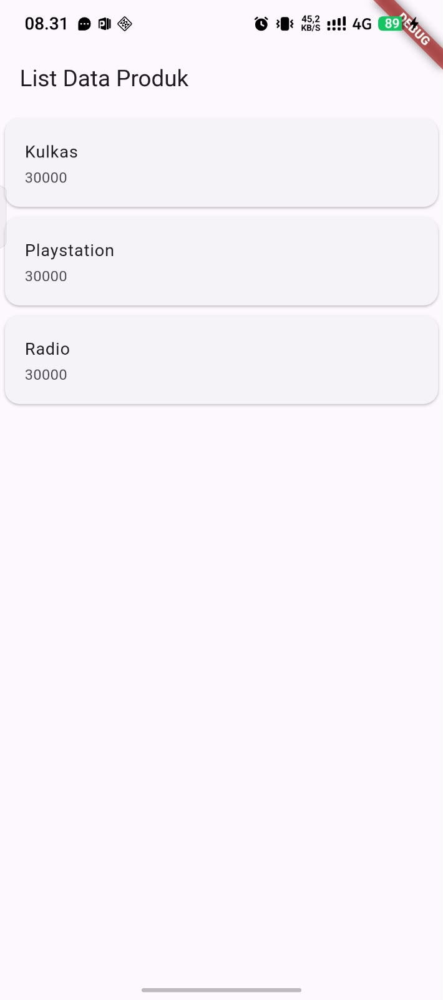
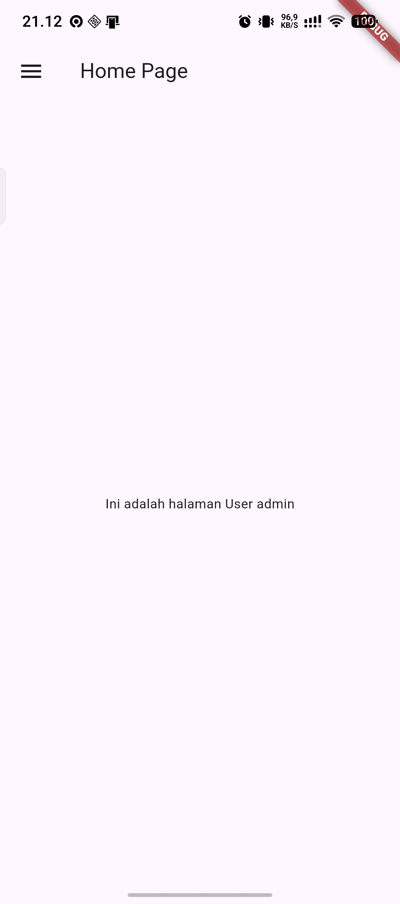
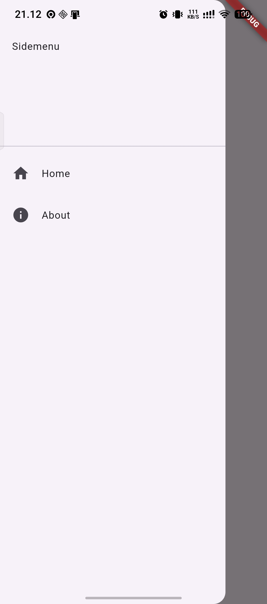

# Laporan Praktikum Pemrograman Mobile

**Nama**        : Ermas Muhammad Syatafa  
**NIM**         : H1D024030  
**Shift**       : Awal A / Akhir C  
**Praktikum**   : Pemrograman Mobile

---

## 📝 Tugas Pertemuan 6
**Tanggal**: Selasa, 27 Oktober 2026

**Kesimpulan Praktikum:**  
Pada pertemuan keenam, praktikum membahas dasar-dasar bahasa pemrograman Dart dan pengenalan framework Flutter untuk pengembangan aplikasi mobile. Praktikum mencakup pemahaman struktur project Flutter, penggunaan widget, serta implementasi beberapa widget dasar seperti `MaterialApp`, `Scaffold`, `AppBar`, `Text`, `Column`, dan `Row`. Selain itu, mahasiswa mempraktikkan pembuatan Form Produk, halaman Detail Produk, serta menampilkan data menggunakan `ListView`, `Card`, dan `ListTile`. Praktikum ini memberikan pemahaman awal mengenai konsep penyusunan antarmuka aplikasi menggunakan Flutter.

---

## 📝 Tugas Pertemuan 7

**Tanggal**: Selasa, 3 November 2026

**Kesimpulan Praktikum:**  
Pada pertemuan ketujuh, praktikum membahas pembuatan sistem login, navigasi halaman (Routes), Side Menu, dan penyimpanan data lokal (Local Storage) menggunakan framework Flutter. Praktikum diawali dengan menambahkan dependency `SharedPreferences` untuk menyimpan username ke dalam penyimpanan lokal. Selanjutnya, mahasiswa membuat halaman login dengan validasi username dan password, halaman Home untuk menampilkan username yang tersimpan, serta halaman About. Praktikum juga menerapkan navigasi antarhalaman menggunakan `Navigator.push` dan membuat Side Menu menggunakan komponen `Drawer`, `ListView`, dan `ListTile`. Melalui praktikum ini, mahasiswa memahami penerapan autentikasi sederhana, penyimpanan data lokal, dan navigasi antarhalaman dalam aplikasi Flutter.